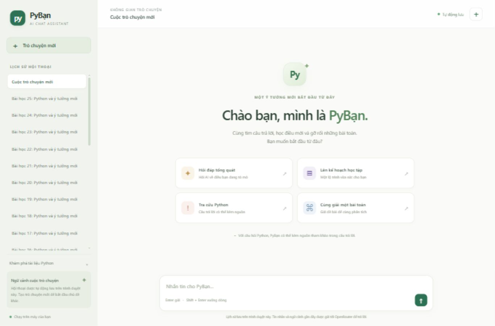
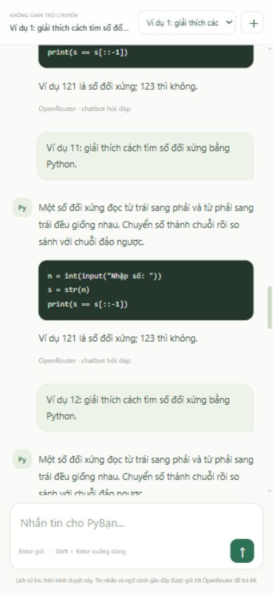

# Thiết kế giao diện và kiểm tra cuộn

## Thay đổi ngày 06/11/2026

Giao diện dùng khung ứng dụng cao bằng cửa sổ (`100dvh`). Thanh đầu trang và vùng nhập tin nhắn nằm ngoài vùng cuộn; phần nội dung hội thoại cuộn riêng. Sidebar cũng dùng khung cố định với lịch sử cuộn riêng, nút tạo chat ở đầu và ghi chú lưu trữ ở cuối. Mục tài liệu Python được thu gọn để nhường chỗ cho lịch sử.

Stylesheet đã được viết lại có cấu trúc, tăng cỡ chữ và chiều cao dòng, thống nhất màu xanh lá dịu, khoảng cách, trạng thái chọn và đường viền. Khối code cuộn ngang bên trong. Trên màn hình nhỏ, danh sách chat chuyển thành hộp chọn ở đầu trang; textarea dùng chữ 16px và khoảng đệm theo safe area.

Hàm hiển thị tin nhắn chỉ điều chỉnh `scrollTop` của `#chat-scroll`, không gọi `scrollIntoView` làm cuộn các vùng bao ngoài. Navbar và ô nhập không bị đẩy khỏi khung khi mở một hội thoại dài.

## Minh chứng kiểm tra

Kiểm tra bằng trình duyệt với dữ liệu giả ở cổng riêng 8767, không đọc hội thoại thật và không gọi OpenRouter. Công cụ tái lập: `python tests/layout_server.py`, mở `/preview` (trang chào) hoặc `/preview?chat=long` (36 tin nhắn và 26 hội thoại mẫu).

| Tình huống | Quan sát thực tế |
|---|---|
| Desktop, viewport yêu cầu 1365 × 900, hội thoại dài | Nội dung cuộn riêng, sidebar và ô nhập nằm trọn trong cửa sổ. |
| Cuộn nội dung desktop từ cuối lên nhiều trang | `chatScrollTop` thay đổi khoảng 5587 → 401; vị trí navbar vẫn `top=0`, trang ngoài vẫn `scrollTop=0`. |
| Mobile, viewport yêu cầu 390 × 844 | Header, hộp chọn hội thoại và ô nhập hiện đầy đủ; `documentWidth=390`, không tràn ngang. |
| Cuộn nội dung mobile nhiều trang | `chatScrollTop` thay đổi tới khoảng 3486; navbar vẫn `top=0`, trang ngoài vẫn `scrollTop=0`. |
| Lưu/chuyển chat khi đang chờ AI | Bộ kiểm tra `node --test tests/conversations.cjs` đạt 4/4 sau thay đổi giao diện. |

Chưa kiểm tra bàn phím ảo trên điện thoại vật lý. Ảnh dưới là dữ liệu minh họa, không phải kết quả đánh giá chất lượng mô hình.

